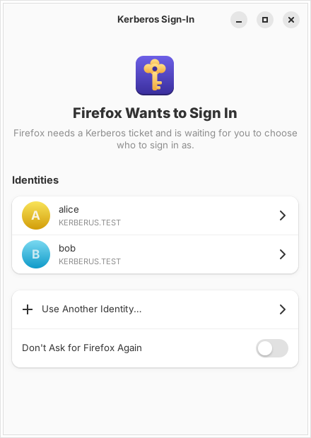
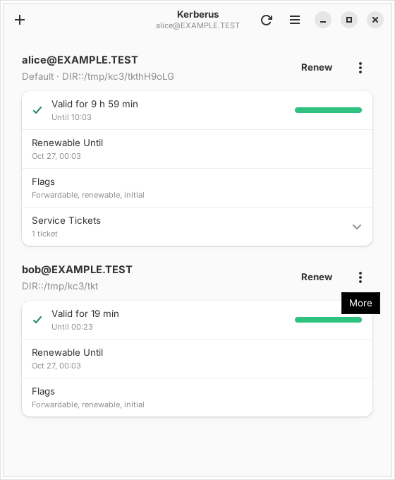
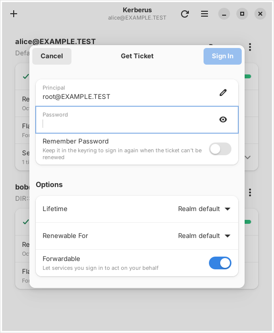

# Kerberus

A GTK 4 / libadwaita app for Kerberos tickets. It sits in the tray, keeps your
tickets renewed so they don't run out in the middle of the day, and, when an app
needs to sign in with Kerberos (a browser opening an intranet site, the file
manager opening a Windows share, `ssh`, `smbclient`) and you don't have a
ticket, pops up and asks which identity to sign in as. The app carries on once
you have.

<p align="center">
  
  
  
</p>

Kerberus drives the MIT Kerberos tools (`kinit`, `klist`, `kdestroy`, `kswitch`,
`kpasswd`), so it uses the machine's own `krb5.conf` and credential caches
(`FILE:`, `DIR:`, `KEYRING:` or `KCM:`): tickets it gets are the ones every other
program sees. The AppImage also carries its own copies of the tools, used when the
host has none.

## Install

Download `Kerberus-<version>-x86_64.AppImage` from the
[latest release](https://github.com/tahuffman1s/kerberus/releases/latest), then

```sh
chmod +x Kerberus-*-x86_64.AppImage
./Kerberus-*-x86_64.AppImage
```

It needs glibc 2.39 or newer (Ubuntu 24.04, Debian 13, Fedora 40, current Arch or
openSUSE Tumbleweed) and the usual desktop libraries (Mesa/GL, Vulkan loader,
fontconfig, X11/Wayland client libraries). Each release also has a `.zsync` file,
so [Gear Lever](https://flathub.org/apps/it.mijorus.gearlever) or
AppImageUpdate can update it in place.

On NixOS, turn on `programs.appimage = { enable = true; binfmt = true; };` and
run it as above, and add `krb5` to `environment.systemPackages` if you want the
system's tools used rather than the bundled ones.

## Sign-in prompts for apps

Turn this on from the banner in the main window or *Preferences → Sign-In
Prompts*, then log out and back in.

Kerberos apps don't tell anyone when they want to sign in, but they all read
their tickets from a credential cache, and MIT Kerberos has a cache type (`KCM:`)
that is a daemon on a socket. With prompts on, Kerberus is that daemon for your
session: it writes `~/.config/environment.d/60-kerberus.conf`, which gives every
app started after you log in `KRB5CCNAME=KCM:` and a `KRB5_CONFIG` that puts
`~/.config/kerberus/krb5.conf` (naming Kerberus's socket) in front of your
system's `krb5.conf`. When an app asks for a ticket and there isn't a valid one,
Kerberus first tries without bothering you (renewing, or the saved password of
the identity that cache belonged to), and otherwise:

- the sign-in window opens, naming the app, with the identities you've used
  before. Click one and type its password (or nothing, if it's saved), or use
  another identity;
- the app's request waits meanwhile (two minutes by default, *Apps Wait For*),
  then gets the ticket as though you'd been signed in all along;
- **Cancel** (or Escape) answers the app straight away, and that app isn't asked
  about again for five minutes. *Don't Ask for … Again* stops it for good
  (undo it under *Apps That Never Ask*).

The Kerberos tools themselves (`klist`, `kinit`, `kdestroy` …) never trigger a
prompt. Tickets are kept in `$XDG_RUNTIME_DIR/kerberus/` (readable only by you,
gone when you log out), so they survive Kerberus restarting. While Kerberus
isn't running, apps can't get tickets at all, which is why turning prompts on
also turns on *Start at Login* and *Run in Background*.

Things to know:

- **Browsers** only try Kerberos for sites you've allowed:
  `network.negotiate-auth.trusted-uris` in Firefox's `about:config` (for example
  `.example.com`), or the `AuthServerAllowlist` policy in Chrome and Chromium.
- **NTLM.** Windows sign-in ("Negotiate") uses Kerberos when there's a ticket
  and falls back to NTLM when there isn't. Kerberus sees and answers the
  Kerberos attempt, which is what makes the fallback unnecessary. Apps that do
  NTLM by themselves (Firefox's and Chrome's built-in NTLM, with their own
  password dialogs) never go through anything Kerberus can see, so it can't
  prompt for those.
- **Flatpak and Snap apps** don't see the session's Kerberos settings, so they
  aren't covered.
- `KERBERUS_DEBUG=1 kerberus` logs every request apps make, with the program
  that made it.

## Using it

- **Get Ticket** (`Ctrl+N`) signs in with a password. *Remember Password* saves it
  in the keyring (GNOME Keyring or KWallet, through the Secret Service) so Kerberus
  can sign in again by itself when a ticket can't be renewed any more.
- Each principal shows how long its ticket-granting ticket is valid, how long it can
  be renewed, its flags and its service tickets. The ⋮ menu makes a principal the
  default, changes its password, forgets its saved password or destroys its tickets.
- If the password has expired, signing in offers to change it, then signs in with
  the new one.
- **Tray icon.** The icon is grey when you're not signed in and gets an orange
  badge when a ticket is about to expire or an app is waiting for you. Clicking it
  shows or hides the window; its menu lists your tickets and has *Choose
  Identity…*, *Renew Tickets*, *Open Kerberus* and *Quit*. The tray works on KDE,
  in GNOME with the [AppIndicator extension](https://extensions.gnome.org/extension/615/appindicator-support/)
  (Ubuntu ships it on), and in other StatusNotifierItem hosts such as waybar.

**Renewal.** While it runs, Kerberus checks every 30 seconds. A renewable ticket is
renewed when it has less than an hour left (*Preferences → Renew Ahead*), or half
way through its life if that is sooner. When it can't be renewed (not renewable,
or past its renew-until time) and a password is saved, Kerberus signs in again. A
saved password that the KDC rejects is not tried again until you sign in by hand,
so a changed password can't lock your account. Otherwise you get a notification
before the ticket expires (*Warn Ahead*).

**Background.** Tickets are only renewed while Kerberus is running. *Run in
Background* (on by default) keeps it in the tray after the window is closed (quit
from the tray, the menu or with `Ctrl+Q`), and *Start at Login* adds an autostart
entry that starts it hidden.

### Command line

The same things work from a terminal, without a window:

```
kerberus list [--json]                  caches and tickets
kerberus get alice [--remember]         sign in (reads the password from the terminal or stdin)
kerberus get svc/host --keytab FILE     sign in with a keytab
kerberus renew [PRINCIPAL | --all]
kerberus switch PRINCIPAL               make it the default (kswitch)
kerberus passwd [PRINCIPAL]
kerberus destroy [PRINCIPAL | --all]
kerberus forget PRINCIPAL               remove a saved password
kerberus watch [--once]                 renew in the foreground (e.g. a systemd user service)
kerberus watch --kcm                    ... and be the credential cache, without prompts
kerberus --background                   start hidden and keep renewing
```

With the AppImage, run it as `./Kerberus-*.AppImage list`, and so on.
`KERBERUS_TOOLS=host` or `KERBERUS_TOOLS=bundled` picks which Kerberos tools
the AppImage uses; `kerberus --version` says which it found.

Settings live in `~/.config/kerberus/settings.json`.

## Releases

[`.github/workflows/build.yml`](.github/workflows/build.yml) runs on every push and
pull request: unit tests, integration tests against a throwaway KDC (with an
ordinary cache and with Kerberus as the cache), the sign-in prompt and tray test,
the AppImage build, a smoke test of the window under Xvfb, and the integration and
prompt tests again against the AppImage (with the host's Kerberos tools and with
its own). The AppImage is uploaded as a workflow artifact.

A push to `main` that passes is released: the workflow tags the next version and
publishes a GitHub release with the AppImage and its `.zsync`. The version comes
from the commits since the last tag ([`packaging/next-version.sh`](packaging/next-version.sh)):

| Commits since the last tag contain                                    | Release        |
| --------------------------------------------------------------------- | -------------- |
| nothing special                                                       | 1.4.2 → 1.4.3  |
| a subject starting `feat:`, or `[minor]` anywhere                     | 1.4.2 → 1.5.0  |
| `type!:` in a subject, `BREAKING CHANGE` in a body, or `[major]`      | 1.4.2 → 2.0.0  |

`[skip release]` in the pushed commit builds without releasing. Changes to
Markdown files and `LICENSE` alone don't start a build. The first release is 0.1.0.

## Development

Everything is in [`kerberus.py`](kerberus.py): the Kerberos tool wrappers and
`klist` parsing, the renewal logic shared by the window and `kerberus watch`, the
KCM server (the protocol MIT's `cc_kcm.c` speaks), the CLI, and the GUI with its
sign-in window and tray icon (a StatusNotifierItem with a `com.canonical.dbusmenu`
menu, over GDBus). Run it from a checkout with the distro's PyGObject, GTK 4,
libadwaita (1.5 or newer) and libsecret typelibs installed:

```sh
python3 kerberus.py
python3 -m unittest discover -s tests          # no KDC needed
tests/integration.sh python3 kerberus.py        # starts its own KDC; needs krb5-kdc and krb5-admin-server
KERBERUS_KCM=1 tests/integration.sh python3 kerberus.py   # the same, with Kerberus as the credential cache
tests/prompt_e2e.sh python3 kerberus.py         # the prompt and tray on Xvfb; needs xdotool and dbus-x11
```

The tests run `krb5kdc` and `kadmind` as your user on ports 18888–18890
(`KDC_PORT=` moves them) with everything in a temporary directory
([`tests/kdc.sh`](tests/kdc.sh)), so they don't touch `/etc/krb5.conf` or your
tickets. The prompt test plays an app with a renamed copy of `kvno`, answers the
sign-in window from the keyboard, and reads the tray icon through a stand-in tray
host ([`tests/fake_tray_host.py`](tests/fake_tray_host.py)).

### Building the AppImage

On Ubuntu 24.04 (what the workflow runs on):

```sh
sudo packaging/appimage/deps.sh
packaging/appimage/build.sh 1.2.3        # -> dist/Kerberus-1.2.3-x86_64.AppImage
```

[`build.sh`](packaging/appimage/build.sh) copies the distro's Python, PyGObject,
the GObject introspection typelibs the app uses (and the libraries they name),
the SVG pixbuf loader, the Adwaita symbolic icons and the Kerberos tools into an
AppDir. [`bundle_libs.py`](packaging/appimage/bundle_libs.py) follows each ELF's
`DT_NEEDED` entries to bundle what they link against and sets every RUNPATH to
`usr/lib`, leaving glibc, graphics drivers and the other libraries on the AppImage
project's excludelist to the host. [`AppRun`](packaging/appimage/AppRun) points
GTK and GObject introspection at the bundle and saves the host's values of what it
changes, which `kerberus.py` restores for the Kerberos tools it runs. Then
appimagetool packs it.

## License

MIT
